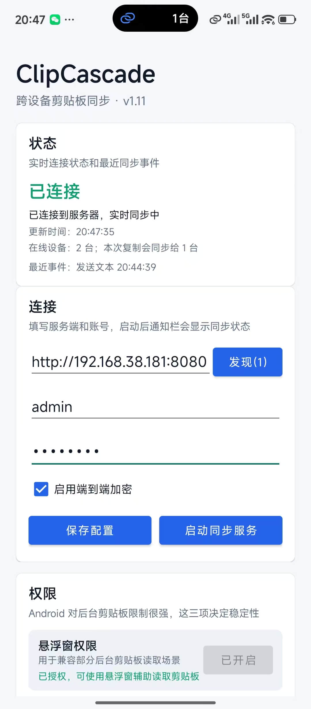

# ClipCascade Go

# ClipCascade Go

[](README_en.md)
[](README.md)

一个面向多设备协作的跨平台剪贴板同步工具。
目标不是"再造一个聊天工具"，而是让跨设备复制粘贴尽量接近本机体验。

## 项目介绍

在日常开发和办公场景里，Mac、Windows、Linux、Android 经常混用。
文本、截图、文件在不同设备之间来回传，会出现这些问题：

- 需要手动打开中转工具，打断工作流。
- 不同平台剪贴板行为差异大，体验不一致。
- 文件传输要么太重，要么太慢，且难统一管理。

ClipCascade 的定位是：以剪贴板为中心，做一个可自部署、可扩展、可跨平台的同步系统。

## 核心能力

- 文本同步：复制后实时同步到在线设备。
- 图片同步：跨平台传输图片剪贴板内容。
- 文件同步：支持小文件直传、中等文件 HTTP 自动中转、大文件 Web 延迟下载的分层策略。
- 传输通道：支持 STOMP（服务端中转）+ P2P（点对点）双通道。
- 安全能力：支持 E2EE 开关。
- 服务端自动化：支持规则触发、审计任务和 WASI 插件占位能力。
- 自动发现：局域网 mDNS 自动发现服务地址。
- 多用户管理：支持管理员在 Web 页面直接新增用户。
- Android 原生保活：前台服务 + 无障碍触发 + 权限引导。
- 剪贴板历史：移动端支持历史记录查看和回填。

## 支持平台

| 模块 | 平台 |
| --- | --- |
| Server | Linux / macOS / Windows |
| Desktop（托盘版） | Linux / macOS / Windows |
| Desktop UI（Fyne） | Linux / macOS / Windows |
| Android 原生保活版 | Android |
| Web 网页剪贴板 | Linux / macOS / Windows（单二进制） |

## 当前技术实现

这一节只描述当前仓库里已经落地的技术方案，便于后续排查平台差异和行为预期。

### 服务端

- 基于 Go + Fiber。
- WebSocket 中转使用类 STOMP 协议。
- 数据库存储使用 GORM + SQLite。
- 局域网自动发现使用 mDNS / Zeroconf。
- 支持管理员 Web 页面直接管理用户。
- 自动化框架默认关闭；开启后可通过规则匹配剪贴板事件，并调用 Go action、白名单命令或 WASI 插件。

### 桌面端传输层

- 主通道：STOMP over WebSocket。
- 辅助通道：P2P WebRTC DataChannel。
- 自动重连：桌面端会在检测到连接断开后立即发起首轮重连，失败后再进入指数退避。
- 当前实现仍以服务端中转为保底，P2P 可用时会并行承载数据。

### 桌面端剪贴板实现

- 文本、图片、文件最终都会归并到统一的业务类型：
  - `text`
  - `image`
  - `file_eager`
  - `file_stub`
- 没有单独的“内存图片”协议类型；截图、位图、应用内图片剪贴板对象都归入 `image`。
- 为避免图片在不同平台来回写入时被系统重编码后触发回环，图片去重已改为“按解码后的像素内容计算哈希”，而不是直接按原始字节做哈希。

### 各平台剪贴板差异

#### macOS

- 使用 `NSPasteboard` 的 CGO 原生调用。
- 通过 `changeCount` 轮询变化，再按优先级读取：
  1. 文件路径
  2. 图片对象
  3. 文本
- 这意味着 macOS 现在可以直接识别很多“内存里的截图图片”，例如微信截图，不需要先粘贴到别的应用再复制。

#### Windows

- 使用系统剪贴板序列号检测变化。
- 文件路径通过 `CF_HDROP` 原生读写；接收远端文件后会写入系统文件剪贴板，支持在资源管理器、聊天窗口等位置直接 `Ctrl+V` 粘贴。
- 文本通过 `CF_UNICODETEXT` 原生读取。
- 图片读取通过 `CF_DIB / CF_DIBV5`，并转换为 PNG 后进入统一的 `image` 同步链路。
- 图片写入会把 PNG/JPEG/WebP/GIF 等远端图片载荷规范化为 Windows 图片剪贴板格式（`CF_DIB`、`CF_DIBV5`、PNG 注册格式），保证 Android 分享图片到 Windows 后仍按图片粘贴，而不是降级成文件路径。
- 这部分是为了补齐“截图直接进入剪贴板但通用库读不到”的场景。

#### Linux

- 文本/图片监听主要依赖 `golang.design/x/clipboard` 的事件通道。
- 文件剪贴板通过 `xclip` 读写（Wayland 会话优先 `wl-copy`/`wl-paste`）。**写入的 target 按桌面环境选择**：统信 UOS / deepin / GNOME 系使用 `x-special/gnome-copied-files`（数据格式为 `copy\nfile://...`），KDE 使用 `text/uri-list`；读取时会依次尝试多个 target。写错 target 的典型症状是文件管理器能看到剪贴板更新、但 Ctrl+V 粘不出文件。
- 写入剪贴板时会 fork 一个后台属主进程持有 selection。xclip / wl-copy 默认后台运行但**不关闭继承来的 stdout/stderr**，因此不能用 `CombinedOutput`/`Output` 捕获它们，否则调用方会阻塞到剪贴板被其它程序接管为止。
- Linux 当前更接近“标准剪贴板格式驱动”的实现，对桌面环境依赖相对更强。

### 当前设计取舍

- 文本与标准图片默认是“复制即同步”。
- 文件不强行全部直传，而是区分小文件直传、中等文件自动 HTTP relay、大文件仅登记到 Web 的延迟下载。
- 文件分级统一为：`<= 8 MiB` 的 `file_eager`、`> 8 MiB 且 <= 25 MiB` 的 HTTP relay、`> 25 MiB 且 <= 2 GiB` 的 deferred 登记。
- Android 无法可靠地把文件写入系统剪贴板，因此接收文件只进入应用历史：`file_eager` 只保留最近一个临时副本，`file_offer` 只保留下载元数据，用户点击后统一保存到公共 `Download` 目录。
- Android 接收图片会在应用内预览，点击保存后写入公共 `Download` 目录。临时缓存不启动定时任务，也不额外持有唤醒锁。
- 对截图类内容，当前策略仍然是直接按图片同步，而不是要求用户“先粘贴再复制”。
- 如果某个平台的截图工具把内容放进了非标准私有格式，仍可能需要继续补平台适配，这属于剪贴板读取层问题，不是协议层新增类型。

## 快速开始
> 以 macOS 为例 服务端启动


> 以 macOS 为例 桌面端启动


> win 桌面端


| Android 桌面端启动 | Desktop UI 端 |
| :---: | :---: |
|  |  |

那么这么棒的软件，它有没有带 UI 端的？
有的兄弟，包有的。PC 端这里也有 UI 的部分，而且都附带网络自动发现。

如果要手动指定账户密码的话，可以这样
```
./build/clipcascade-desktop-ui-darwin-arm64 --server http://127.0.0.1:8080 --username admin --password admin123 --save
```

## 解决什么问题

### 1) 网络问题
不需要切换软件就能直接同步到另一台电脑
不同平台的剪切板不够不互通
不需要安装什么奇怪的输入法登录同步
不需要联网敏感
数据也能发

### 2) Android
很多软件在安卓10以上之后，它就不能在后台了。常驻后台。需要开启一串的东西，因为手机端主要是保证续航。
很多的常规打包软件都是不具备这样的能力的，需要编写特定化的代码。(当然这里我已经做了)

## Web 网页剪贴板（server-web-clip）

不依赖 ClipCascade 账号体系，独立运行，适合局域网内快速传文字和文件。

```bash
./build/clipcascade-web-darwin-arm64
```

启动后打印数据路径和访问地址：

```
  database : /path/to/binary/data.db
  uploads  : /path/to/binary/uploads/
  ➜  http://localhost:8090/
```

**命令行参数：**

```bash
./build/clipcascade-web-darwin-arm64 -p 9000
# 或
./build/clipcascade-web-darwin-arm64 --port 9000
```

**环境变量（命令行参数优先级更高）：**

| 环境变量 | 默认值 | 说明 |
| --- | --- | --- |
| `WEBCLIP_PORT` | `8090` | 端口，占用自动+1 |
| `WEBCLIP_DB_PATH` | 二进制目录/data.db | 数据库路径 |
| `WEBCLIP_UPLOAD_DIR` | 二进制目录/uploads | 上传目录 |

构建：

```bash
./build-scripts/build.sh web-clip-cross
```

产物：`build/clipcascade-web-{os}-{arch}`

## 执行构建

### 1) 一键构建

```bash
./build-scripts/build.sh all
```

`all` 会尝试构建：
- server 全平台
- desktop 全平台
- desktop-ui（当前平台）
- desktop-ui-cross（macOS UI 本机双架构；Windows/Linux UI 依赖 Docker）

说明：
- Linux desktop 交叉编译依赖 Docker daemon（未启动会被跳过并告警）。
- 在 macOS 主机上，即使 Docker 未启动，`desktop-ui-cross` 也会尝试产出 `clipcascade-desktop-ui-darwin-amd64` 和 `clipcascade-desktop-ui-darwin-arm64`。
- Windows/Linux 的 Fyne UI 交叉编译依赖 Docker + `fyne-cross`，Docker 未启动时会跳过并告警。
- iOS 打包需要 Apple 开发者证书（无证书会告警）。

### 2) 启动服务端

```bash
./build/clipcascade-server-darwin-arm64
```

默认账号：`admin / admin123`

### 3) 启动桌面端

首次保存配置：

```bash
./build/clipcascade-desktop-darwin-arm64 --server http://127.0.0.1:8080 --username admin --password admin123 --save
```

调试日志：

```bash
./build/clipcascade-desktop-darwin-arm64 --debug
```

临时发送过滤（仅本次运行生效，不写入配置）：

```bash
./build/clipcascade-desktop-darwin-arm64 --send-filter=text,file
```

`--send-filter` 可选值：`all`(默认)、`none`、`text`、`image`（截图，不是文件）、`file`，支持逗号组合（如 `text,file`）。

日志体积口径说明（客户端 vs 服务端）：

- 默认启用 E2EE 时，客户端日志中的“大小”是明文 payload 的估算大小。
- 服务端日志中的“体积”在 E2EE 场景下通常是加密后帧体（wire body）大小。
- 因此同一条消息在客户端与服务端看到的数值可能不一致，这属于预期行为。
- 若关闭 E2EE，双方更容易出现接近的体积数值。

## 用户管理

- 默认 `signup` 关闭。
- `/signup` 在关闭时会返回 `Signup is disabled`。
- 登录页在 `signup` 关闭时不再显示"Create an account"。

新增用户（无需手调接口）：

1. 管理员登录后打开 `/advance`。
2. 点击 `+ Add User`。
3. 输入用户名和密码即可创建。

## 服务端自动化与插件

自动化默认关闭，不影响现有同步链路。关闭 E2EE 时，服务端可以解析明文文本、URL 和图片元信息；开启 E2EE 时，服务端只能处理 envelope 元数据。

插件采用目录包格式。官方轻量插件优先使用 WASI，因此同一个 `.wasm` 文件可跨 Linux、macOS、Windows 运行；重型本地能力继续通过 `run_command` 白名单调用外部程序。

```text
plugins/
  content-redact/
    clipcascade.plugin.jsonc
    README.md
    content-redact.wasm
```

`clipcascade.plugin.jsonc` 示例：

```jsonc
{
  // publisher 和 name 共同组成插件唯一 ID: example.content-redact
  "publisher": "example",
  "name": "content-redact",
  // displayName 用于网页插件页展示。
  "displayName": "Content Redaction",
  "description": "Detects and redacts sensitive clipboard text.",
  "version": "0.1.0",
  "license": "MIT",
  // categories 和 keywords 用于搜索、筛选和后续插件市场展示。
  "categories": ["Automation", "Security"],
  "keywords": ["clipboard", "redact", "privacy"],
  // engines 声明运行时兼容范围。
  "engines": {
    "clipcascade": ">=2.0.0",
    "wasi": "wasip1"
  },
  // activationEvents 只做能力声明，当前不自动注册规则。
  "activationEvents": [
    "onClipboard:text",
    "onCapability:content_redact"
  ],
  // repository 可选；私有插件可以删除这一块。
  "repository": {
    "type": "git",
    "url": "https://github.com/example/content-redact"
  },
  "author": {
    "name": "Example"
  },
  // contributes 预留插件贡献点，当前只展示和记录。
  "contributes": {
    "automation": {
      "capabilities": ["content_redact"],
      "rules": [],
      "commands": []
    }
  },
  // clipcascade 块是本项目专属字段，所有执行入口和资源限制都必须放在这里。
  "clipcascade": {
    "schemaVersion": 1,
    "enabled": true,
    // 第一阶段只支持 WASI，运行时按需加载。
    "entrypoint": { "type": "wasi", "path": "./content-redact.wasm" },
    "capabilities": ["content_redact"],
    // runtime 块控制单次插件调用的超时和输出上限。
    "runtime": { "timeout_seconds": 30, "max_output_bytes": 65536 }
  }
}
```

说明：

- `README.md` 必须存在，用于 Web 插件页展示说明摘要。
- 插件唯一 ID 遵循 VS Code 风格，由 `publisher.name` 组成；manifest 文件中不再允许顶层 `id`。
- `repository` 可选；私有插件可以不提供仓库地址。
- `clipcascade` 块保存平台专属字段；顶层 `entrypoint`、`capabilities`、`runtime`、`enabled` 会被拒绝。
- `plugins/clipcascade.plugin.schema.jsonc` 提供 manifest JSONC Schema，可用于编辑器校验。
- 第一版官方插件只支持 WASI，通过 stdin/stdout 交换机器载荷。
- URL 下载、图片敏感检测、OCR、内容脱敏、结果回填目前只保留插件能力入口和任务结果记录，不内置具体实现。
- 当前官方插件包含 `url-platform-candidate` 和 `secret-detector`；`url-platform-candidate` 当前优先识别抖音、快手平台 URL，后续可扩展更多平台。
- 官方插件功能、触发规则和执行边界见：[ClipCascade 官方插件说明](_docs/official-plugins.md)。
- 管理员登录后可从首页底部进入 `/plugins` 查看当前插件。
- 构建全部官方插件：`./build-scripts/build.sh plugins`，产物在 `build/plugins/`。
- 发布包推荐把 `clipcascade-server` 和 `plugins/` 放在同一级目录；默认 `CC_AUTOMATION_PLUGINS_DIR=./plugins` 按服务端二进制所在目录解析。

## 同步策略（当前设计）

### 文本/图片

- 复制后实时同步。
- 截图、系统位图、Android 分享图片都归为 `image`，接收端写入图片剪贴板；不会为了兼容性改成文件路径粘贴。

### 文件

- 单文件且大小 `<= 8 MiB`：`file_eager` 直传。
- 单文件且大小 `> 8 MiB 且 <= 25 MiB`：自动走 HTTP relay，接收端后台下载后写入本地剪贴板文件路径。
- 单文件且大小 `> 25 MiB 且 <= 2 GiB`：只登记到服务端 Web 的 deferred 列表，不自动塞进其他设备剪贴板；需要的人在 Web 页面手动请求/下载。
- 多文件或超过上限的文件：继续走 `file_stub` 占位（元信息通知）。

Android 原生端的接收行为：

- `file_eager`：解码到应用缓存，仅保留最近一个；不会写入 Android 系统剪贴板，点击历史记录中的保存按钮后写入 `Download/`。
- `file_offer`：历史记录只保存文件名、大小和 relay ID，不会把文件内容长期存到手机；点击后才从服务端下载到 `Download/`。
- `25 MiB` 以上文件：在“大文件”页查看 deferred 登记并按需下载，最大支持 `2 GiB`。
- 图片：应用内预览，点击保存后写入 `Download/`。

Android 分享发送端因为系统只提供 `content://` 文件源，`<=25 MiB` 文件继续使用 HTTP relay；这不会改变 PC 端接收的三档协议，也不会把大文件预先上传。

接收端 `file_eager` 行为：

- 落盘到临时目录：
  - macOS/Linux: `${TMPDIR}/ClipCascade` 或 `/tmp/ClipCascade`
  - Windows: `%LOCALAPPDATA%\\Temp\\ClipCascade`
- 同时写入系统剪贴板文件路径，用户可直接粘贴。

临时文件清理：

- 接收文件时会自动清理 `24 小时`前的旧临时文件。
- Android 小文件缓存采用“只保留最近一个”策略；Android 发现扫描仅在主界面前台运行，网络变化时才重新扫描。

## 构建与环境

### 环境准备（必看）

基础环境：

- Go `1.22+`（建议与 CI 一致，当前 CI 使用 `1.25`）
- Git
- `PATH` 包含 `$(go env GOPATH)/bin`

按构建目标补充：

- Desktop/Linux 交叉编译：需要 Docker，并确保 Docker daemon 已启动。
- macOS Desktop 构建：需要 Xcode Command Line Tools（`xcode-select --install`）。
- Android 原生保活版（`mobile-android-native`）：
  - JDK `17`
  - Android SDK（`platform-tools`、`platforms;android-34`、`build-tools;34.0.0`）
  - Android NDK（通过 `brew install --cask android-ndk` 安装）
  - `gomobile`（`go install golang.org/x/mobile/cmd/gomobile@latest && gomobile init`）

建议设置的环境变量（已写入 `~/.zshrc`，新终端自动生效）：

```bash
export ANDROID_HOME="/opt/homebrew/share/android-commandlinetools"
export ANDROID_SDK_ROOT="$ANDROID_HOME"
export ANDROID_NDK_HOME="/opt/homebrew/Caskroom/android-ndk/<version>/AndroidNDK*.app/Contents/NDK"
```

说明：

- 项目已内置 `client-android-native-shell/android/gradlew`，不要求全局安装 Gradle。
- 若遇到 Gradle 缓存污染，可删除根目录 `.gradle-user-home/` 后重试。

### Linux 运行时依赖

Linux 桌面端和图形化桌面 UI 都依赖 CGO，无法纯静态编译，除二进制本身外还需要系统库。按使用目标安装：

#### 隐形式桌面托盘端（`clipcascade-desktop-linux-amd64`）

```bash
# Debian / Ubuntu / 统信 UOS / deepin
sudo apt install libgtk-3-0 libayatana-appindicator3-1 libx11-6 xclip
```

| 依赖 | 用途 | 缺失后果 |
|------|------|----------|
| `libgtk-3-0` | 托盘界面的 GTK3 运行时 | 启动失败 |
| `libayatana-appindicator3-1` | 托盘图标注册 | 启动失败 |
| `libx11-6` | 文本/图片剪贴板读写（运行期 `dlopen`，非链接期） | 文本与图片同步不可用 |
| `xclip` | 文件剪贴板读写（target 见下方说明） | 仅文件同步不可用，文本与图片正常 |

Wayland 会话下文件剪贴板会优先走 `wl-copy` / `wl-paste`，装了 `wl-clipboard` 包更好。

文件剪贴板的 target 由桌面环境决定。GNOME 系文件管理器（含统信 UOS / deepin 的 `dde-file-manager`，其源码只认 `kGnomeCopyKey` 常量 `x-special/gnome-copied-files`）需要 `x-special/gnome-copied-files` 且数据带 `copy\n` 前缀；KDE (Dolphin) 使用 `text/uri-list`。在 UOS/deepin 上只写 `text/uri-list` 会让文件管理器感知到剪贴板变化、却粘不出任何文件。

托盘端链接的是 `libayatana-appindicator3`，不是老的 `libappindicator3`。两者是同一次 fork、ABI 兼容，但 soname 不同，不能互相顶替：统信 UOS V20 只提供 `libayatana-appindicator3.so.1`，所以构建也统一用 ayatana（Debian 10 自带 `libayatana-appindicator3-dev`）。

#### 图形化桌面 UI（`clipcascade-ui-desktop-linux-amd64`）

```bash
sudo apt install libgl1 libx11-6 libxcursor1 libxrandr2 libxinerama1 libxi6 libxxf86vm1
```

Fyne 需要 OpenGL 2.0+。虚拟机和没有独显驱动的环境装 Mesa 软件渲染兜底：

```bash
sudo apt install libgl1-mesa-dri
```

该产物不需要 `libappindicator3` 和 webkit2gtk：Fyne 的 Linux 托盘走 `fyne.io/systray` 的纯 Go D-Bus 实现，Fyne v2.7 也不依赖 webkit。

#### glibc 版本要求

CI 的 `linux-amd64` 产物在 Debian 10 容器内编译，**只要求 glibc ≥ 2.28**，覆盖统信 UOS V20、deepin 20、Debian 10+、Ubuntu 18.10 及更新的发行版。

如果目标系统比这更老（例如基于 CentOS 7 的发行版，glibc 2.17），官方产物无法直接运行，需要在该系统内自行编译。`build-scripts/build_linux_legacy.sh` 记录了所需的系统依赖与编译参数，可参照改成对应发行版的包管理命令；其中的 GLIBC 守卫（用 `objdump -T` 校验产物符号版本上限）建议保留。

### 常用构建命令

```bash
./build-scripts/build.sh server
./build-scripts/build.sh server-cross
./build-scripts/build.sh desktop
./build-scripts/build.sh cross
./build-scripts/build.sh desktop-ui
./build-scripts/build.sh desktop-ui-cross
./build-scripts/build.sh mobile-android-native
```

`mobile-android-native` 产物：

- `build/ClipCascade-Android-Installable.apk`（可直接安装）

### Windows 黑框模式

- 默认：Windows 桌面端保留控制台黑框（便于看日志）。
- 无黑框托盘模式：

```bash
CLIPCASCADE_WINDOWS_GUI=1 ./build-scripts/build.sh cross
```

## 环境变量

### Server 运行时

相对路径默认按服务端二进制所在目录解析，推荐发布包结构为 `clipcascade-server` 同级放 `database/`、`uploads/`、`plugins/`。

| 环境变量 | 默认值 | 说明 |
| --- | --- | --- |
| `CC_PORT` | `8080` | 服务端监听端口 |
| `CC_MAX_MESSAGE_SIZE_IN_MiB` | `20` | WebSocket 单消息大小上限，单位 MiB |
| `CC_MAX_MESSAGE_SIZE_IN_BYTES` | `0` | WebSocket 单消息大小上限，单位字节；大于 0 时优先生效 |
| `CC_P2P_ENABLED` | `false` | 是否启用 P2P 信令与 P2P 同步模式 |
| `CC_P2P_STUN_URL` | `stun:stun.l.google.com:19302` | WebRTC STUN 地址 |
| `CC_ALLOWED_ORIGINS` | `*` | CORS 允许来源，多个来源用逗号分隔 |
| `CC_SIGNUP_ENABLED` | `false` | 是否开放自助注册 |
| `CC_MAX_USER_ACCOUNTS` | `-1` | 最大用户数量；`-1` 表示不限制 |
| `CC_ACCOUNT_PURGE_TIMEOUT_SECONDS` | `-1` | 账号清理超时；`-1` 表示关闭 |
| `CC_SESSION_TIMEOUT` | `525960` | 登录会话有效期，单位分钟 |
| `CC_MAX_UNIQUE_IP_ATTEMPTS` | `15` | 暴力破解防护：唯一 IP 尝试阈值 |
| `CC_MAX_ATTEMPTS_PER_IP` | `30` | 暴力破解防护：单 IP 尝试阈值 |
| `CC_LOCK_TIMEOUT_SECONDS` | `60` | 触发锁定后的初始锁定时间 |
| `CC_LOCK_TIMEOUT_SCALING_FACTOR` | `2` | 连续触发锁定后的时间放大倍数 |
| `CC_BFA_CACHE_ENABLED` | `true` | 是否启用暴力破解防护缓存 |
| `CC_DATABASE_PATH` | `./database/clipcascade.db` | SQLite 数据库路径 |
| `CC_FILE_RELAY_ENABLED` | `true` | 是否启用 HTTP 文件中转 |
| `CC_FILE_RELAY_DIR` | `./uploads` | HTTP 文件中转存储目录 |
| `CC_FILE_RELAY_MAX_BYTES` | `2147483648` | HTTP 文件中转单文件最大大小，默认 2 GiB |
| `CC_FILE_RELAY_TTL_SECONDS` | `86400` | HTTP 文件中转文件保留时间 |
| `CC_EXTERNAL_BROKER_ENABLED` | `false` | 是否启用外部 STOMP broker |
| `CC_BROKER_HOST` | `localhost` | 外部 broker 主机 |
| `CC_BROKER_PORT` | `61613` | 外部 broker 端口 |
| `CC_AUTOMATION_ENABLED` | `false` | 是否启用服务端自动化引擎 |
| `CC_AUTOMATION_MODE` | `observe` | 自动化模式：`observe` 只观察，`enforce` 执行阻断 |
| `CC_AUTOMATION_RULES_PATH` | 空 | 自动化规则 JSONC 文件路径 |
| `CC_AUTOMATION_COMMANDS_PATH` | 空 | 本地命令白名单 JSONC 文件路径 |
| `CC_AUTOMATION_PLUGINS_DIR` | `./plugins` | 插件目录；相对路径按服务端二进制所在目录解析 |
| `CC_AUTOMATION_COMMAND_TIMEOUT_SECONDS` | `30` | 本地命令单次执行超时 |
| `CC_AUTOMATION_COMMAND_MAX_OUTPUT_BYTES` | `65536` | 本地命令 stdout 最大读取字节数 |
| `CC_AUTOMATION_PLUGIN_TIMEOUT_SECONDS` | `30` | WASI 插件单次执行超时 |
| `CC_AUTOMATION_PLUGIN_MAX_OUTPUT_BYTES` | `65536` | WASI 插件 stdout 最大读取字节数 |
| `CC_AUTOMATION_TRUSTED_COPY_ENABLED` | `false` | 是否启用 `/api/automation/copy` 可信复制入口 |
| `CC_AUTOMATION_COPY_MAX_BYTES` | `262144` | 可信复制入口请求体大小上限 |

### Web 剪贴板运行时

| 环境变量 | 默认值 | 说明 |
| --- | --- | --- |
| `WEBCLIP_PORT` | `8090` | Web 剪贴板端口，占用时自动加 1 |
| `WEBCLIP_DB_PATH` | 二进制目录 `data.db` | Web 剪贴板数据库路径 |
| `WEBCLIP_UPLOAD_DIR` | 二进制目录 `uploads/` | Web 剪贴板上传目录 |

### 桌面端运行时

| 环境变量 | 默认值 | 说明 |
| --- | --- | --- |
| `CLIPCASCADE_PASSWORD` | 空 | 桌面端密码覆盖；设置后不从本地配置读取密码 |
| `XDG_CONFIG_HOME` | 系统默认 | Linux 配置目录标准变量 |
| `APPDATA` | 系统默认 | Windows 配置目录标准变量 |
| `WAYLAND_DISPLAY` | 系统默认 | Linux 下用于判断是否优先使用 Wayland 剪贴板工具 |

### 构建脚本

| 环境变量 | 默认值 | 说明 |
| --- | --- | --- |
| `VERSION` | `git describe --tags --always` 或 `dev` | 注入二进制版本号 |
| `CLIPCASCADE_WINDOWS_GUI` | `0` | `1` 表示构建 Windows 桌面端时隐藏控制台窗口 |
| `ANDROID_HOME` | 自动探测 Homebrew Android SDK | Android SDK 路径；Android 原生端构建会读取 |
| `ANDROID_SDK_ROOT` | 跟随 `ANDROID_HOME` | Android SDK 标准路径变量；未设置时脚本会用 `ANDROID_HOME` 填充 |
| `ANDROID_NDK_HOME` | 自动探测 | Android 原生端构建使用的 NDK 路径 |
| `CC_ANDROID_API` | `26` | Android 原生端构建 API level |
| `GRADLE_USER_HOME` | 根目录 `.gradle-user-home/` | Android Gradle 缓存目录；默认使用项目内目录避免污染全局缓存 |
| `JAVA_HOME` | 系统默认 | Gradle Wrapper 使用的 JDK 路径；建议 JDK 17 |
| `SDKROOT` | Xcode SDK 自动探测 | macOS CGO 构建 SDK；无效时脚本会清理 |
| `PATH` | 系统默认 | 需要包含 `go`、`gomobile`、`fyne`、`fyne-cross`、`docker` 等构建工具 |

## 常见问题

### 1) Docker 相关构建失败

报错：`Cannot connect to the Docker daemon ...`

处理：

```bash
open -a Docker
# 或
open -a OrbStack
```

确认 `docker info` 正常后重试。

### 2) 登录页点 Create 显示 Signup is disabled

这是配置行为（默认关闭注册）。

- 开启公开注册：`CC_SIGNUP_ENABLED=true`
- 推荐方式：保持关闭，由管理员在 `/advance` 新增用户。

### 3) 文件能收到提示但粘贴不可用

请确认两端都使用最新 desktop 二进制，并检查日志是否出现：

- `应用：准备发送剪贴板更新 类型=file_eager`
- `剪贴板：已接收并写入文件到临时目录`
- Windows 端还应出现 `剪贴板：Windows 已写入文件剪贴板`。如果没有，说明接收端没有成功写入 `CF_HDROP`，请更新 Windows desktop 二进制。

### 4) Android 分享图片到 Windows 后不能粘贴

请确认 Windows desktop 已更新到包含图片规范化写入的版本。Android 分享图片仍按 `image` 同步，Windows 端应写入图片剪贴板格式，而不是把图片保存为文件路径。


### 5) Linux 上启动报 `GLIBC_2.xx not found`

```
./clipcascade-desktop-linux-amd64: /lib/x86_64-linux-gnu/libc.so.6:
version `GLIBC_2.34' not found (required by ./clipcascade-desktop-linux-amd64)
```

这是二进制要求的 glibc 版本高于系统提供的版本。v2.2 之前的产物在 Ubuntu 24.04 上编译，要求 `GLIBC_2.32` / `GLIBC_2.34`，在统信 UOS V20、deepin 20（glibc 2.28）这类 Debian 10 系系统上无法启动。

升级到 v2.2 及之后的产物即可：Linux 产物改为在 Debian 10 容器内编译，只要求 glibc ≥ 2.28。可以这样确认：

```bash
objdump -T clipcascade-desktop-linux-amd64 | grep -oE 'GLIBC_2\.[0-9]+' | sort -uV
```

输出里不应出现高于 `GLIBC_2.28` 的版本。

同时请确认已装齐 [Linux 运行时依赖](#linux-运行时依赖)，尤其是 `libgtk-3-0` 和 `libayatana-appindicator3-1` —— 缺少这两个库同样会在启动阶段直接失败。

## 社区

[LINUX DO](https://linux.do/)

## 开源协议

本项目基于 [Apache License 2.0](LICENSE) 协议开源。
